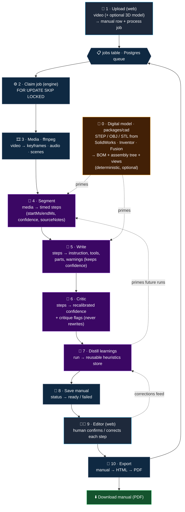

# Vitruvius

**Drop in a video of something being assembled → get back an editable, step-by-step instruction
manual (IKEA-style).**

The positioning is deliberate: _AI-generated draft instructions with a guided human revision editor_
— **not** a fully automatic generator. Every AI output carries a **confidence value** and **source
notes**, and a human confirms or corrects each step before export.

```
  🎥  assembly video                                 📘  step-by-step manual (PDF)
 ────────────────────►   [  Vitruvius pipeline  ]   ────────────────────────────►
                                                       + per-step confidence
                                                       + human-reviewed
```

---

## How it works

The pipeline runs as a chain of small stages — **each node has one clear job, with a defined input,
output, and goal.** A SvelteKit web app handles upload, review, and export; a separate containerized
engine does the heavy lifting. They never talk directly — only through the database and the shared
`@vitruvius/core` contract.

🤖 = the node calls AI (Gemini, behind `packages/ai`). Everything else is deterministic.



> Stages **2–8** run inside the engine container. The web app only ever **enqueues** jobs and
> **polls** `manuals.status` — it never imports the engine or calls AI directly. The dotted edges are
> _priming_: the optional 3D model and the learnings store feed context into the AI nodes; confirmed
> human edits feed back into learnings, closing the loop.

### Each node — input → output, and goal

| #   | Stage (where)                                  | 🤖 AI         | Input → Output                                                                                                                                      | Goal & internal process                                                                                                                                                                                                                                                                                                                                         |
| --- | ---------------------------------------------- | ------------- | --------------------------------------------------------------------------------------------------------------------------------------------------- | --------------------------------------------------------------------------------------------------------------------------------------------------------------------------------------------------------------------------------------------------------------------------------------------------------------------------------------------------------------- |
| 0   | **Digital model** · engine · `packages/cad`    | No · optional | Optional **STEP / OBJ / STL** export (SolidWorks, Inventor, Fusion) → `DigitalModel` (BOM + assembly tree + canonical views) + `digitalModelStatus` | The video alone forces the AI to guess part names and fastener sizes; a CAD export already names them exactly. Deterministically parses the STEP product structure into a bill of materials + assembly tree, decodes part names, renders canonical views — then **primes** Segment & Write. No AI, near-zero cost. A run with no model proceeds on video alone. |
| 1   | **Upload** · web                               | No            | Video file (+ optional model) → `manuals` row (`uploaded`) + a `process` job                                                                        | Store the upload in Supabase Storage, register the manual, enqueue work. Web's only job in processing — it never interprets anything itself.                                                                                                                                                                                                                    |
| 2   | **Claim job** · engine                         | No            | Queued `jobs` row → one leased job                                                                                                                  | Atomically lease a single job with `FOR UPDATE SKIP LOCKED` so parallel workers never grab the same one. No Redis.                                                                                                                                                                                                                                              |
| 3   | **Media** · engine · ffmpeg                    | No            | Video path → keyframes, audio track, scene boundaries, split clips (timestamps + file refs)                                                         | Deterministic ffmpeg extraction — turn raw footage into structured artifacts the AI can reason over. No interpretation here.                                                                                                                                                                                                                                    |
| 4   | **Segment** · engine · `packages/ai`           | **Yes** 🤖    | Media artifacts (+ CAD + learnings priming) → `ManualStep[]` with `startMs`/`endMs`, `confidence`, `sourceNotes`                                    | One structured Gemini call cuts the continuous run into discrete steps with time bounds; sub-chunks only fast/ambiguous sections; caches on a content hash.                                                                                                                                                                                                     |
| 5   | **Write** · engine · `packages/ai`             | **Yes** 🤖    | Segmented steps → enriched steps (`title`, `instruction`, `tools`, `parts`, `warnings`, `alternatives`)                                             | Fill the operative wording per step in one structured call, preserving `sourceNotes`/`confidence` so every field stays traceable to evidence.                                                                                                                                                                                                                   |
| 6   | **Critic** · engine · `packages/ai`            | **Yes** 🤖    | Enriched steps → same steps with recalibrated `confidence` + `critique[]`                                                                           | A _separate_ agent (cheap, text-only, no re-watch) judges whether each instruction is actually supported by its source notes; lowers confidence and flags gaps. Scores only — **never rewrites**. The generator must not grade itself.                                                                                                                          |
| 7   | **Distill learnings** · engine · `packages/ai` | **Yes** 🤖    | Finished + human-corrected run → `Learning` rows                                                                                                    | Extract reusable, generalizable heuristics (tool/part conventions, audio cues) — not per-video transcripts — and store them to prime future runs. Closes the loop: generate → critique → human-correct → learn.                                                                                                                                                 |
| 8   | **Save** · engine                              | No            | Validated `ManualStep[]` → persisted manual; `status: processing → ready / failed`                                                                  | Persist via `packages/db` and flip the status so the web app's poll picks it up.                                                                                                                                                                                                                                                                                |
| 9   | **Editor** · web                               | No · human    | Ready manual → confirmed / corrected steps                                                                                                          | The guided-revision core of the product: a human reviews each step with its `confidence`, `reviewStatus`, `sourceNotes`, and `critique`, then confirms or corrects. Corrections feed back to learnings.                                                                                                                                                         |
| 10  | **Export** · web → engine                      | No            | Confirmed manual → PDF in Storage                                                                                                                   | Web enqueues `export`; engine renders HTML → PDF. **Today:** keyframes (spec 09 bootstrap). **Target:** schematic layout via `illustrationUrl` + `caption`; gate rejects open BOM candidates or unconfirmed steps.                                                                                                                                              |

> 📐 **The digital-model lane (spec 12)** is auxiliary priming, never required: when a 3D model ships
> with the video it sharpens part names; when it doesn't, the pipeline runs on video alone. It does
> **not** produce per-step illustrated output — that is spec 14 (Illustrator / Compositor).

### Product roadmap (client alignment)

Grill-me decisions and gap analysis: [`docs/ai/client-alignment-assessment.md`](docs/ai/client-alignment-assessment.md).

**Phase 1 (client deliverable)** — illustrated manual without pose alignment:

| Addition        | Spec      | Role                                                                           | Status             |
| --------------- | --------- | ------------------------------------------------------------------------------ | ------------------ |
| BOM layer       | 13        | BOM file import + reconcile with CAD; `PartRef[]`; AI only if ambiguous        | Merged (#34)       |
| Illustrate      | 14 tier 1 | Illustrator (video-only path) + Compositor-lite (canonical CAD views + layout) | Implemented        |
| Regenerate      | 16        | Job type from editor; reuses Instructor / Illustrator by scope                 | Implemented        |
| Versioning      | 17        | v1 → v2 enrich on same timeline                                                | Implemented        |
| Editor + export | 08, 09    | BOM disambiguation UI (like `alternatives`); schematic PDF; export gate        | BOM UI in progress |

**Phase 2** — Compositor-full (CAD geometry overlay per step) requires video↔CAD pose alignment
(research; out of scope for spec 12).

Target pipeline order: `… → bom-map → instruct → **critic** → illustrate → …` — Critic stays
text-only. Details: [`docs/ai/architecture.md`](docs/ai/architecture.md).

---

## The web / engine boundary

`apps/web` (SvelteKit) and `apps/engine` (worker) **never import each other**. They communicate only
through the database (the `jobs` table + manual rows) and the shared `@vitruvius/core` contract. This
is a **deploy boundary**, so the engine can later be rewritten in Python / on GPUs or extracted to
its own repo without touching the web app. ffmpeg, Gemini, and Playwright live in the engine only.

## Stack

| Concern           | Choice                                                                                                                                                                       |
| ----------------- | ---------------------------------------------------------------------------------------------------------------------------------------------------------------------------- |
| Language          | TypeScript everywhere                                                                                                                                                        |
| Monorepo tooling  | pnpm workspaces + Turborepo                                                                                                                                                  |
| Web app           | SvelteKit + Tailwind + shadcn-svelte                                                                                                                                         |
| Processing engine | `apps/engine` — standalone containerized worker (own deploy/scale cadence)                                                                                                   |
| Job queue         | Postgres-backed `jobs` table in Supabase (`FOR UPDATE SKIP LOCKED`) — no Redis                                                                                               |
| Database          | Supabase Postgres                                                                                                                                                            |
| File storage      | Supabase Storage                                                                                                                                                             |
| Auth              | Supabase Auth                                                                                                                                                                |
| Video processing  | ffmpeg (inside the engine container)                                                                                                                                         |
| AI runtime        | Google Gemini (video understanding) — stubbed in this bootstrap; credit-aware and provider-pluggable behind `packages/ai` (see [`docs/ai/ai-layer.md`](docs/ai/ai-layer.md)) |
| PDF export        | HTML template + Playwright print-to-PDF (inside the engine container)                                                                                                        |
| Node              | current active LTS                                                                                                                                                           |

## Getting started

```bash
pnpm install
cp .env.example .env   # fill in Supabase + Gemini values
pnpm dev               # turbo runs the web app (and engine) in dev
```

Useful workspace scripts: `pnpm typecheck`, `pnpm lint`, `pnpm build`, `pnpm test`.

## Layout

- `packages/core` — the frozen contract (types + zod schemas + enums).
- `packages/{db,media,ai,export}` — typed stubs, implemented per spec.
- `apps/web` — SvelteKit UI + thin server routes.
- `apps/engine` — the containerized worker.

## Docs & specs

- Architecture map: [`docs/ai/architecture.md`](docs/ai/architecture.md)
- The AI layer (agents, credit budget, Critic, learnings, BYO-license future): [`docs/ai/ai-layer.md`](docs/ai/ai-layer.md)
- Infrastructure & env vars: [`docs/ai/infra.md`](docs/ai/infra.md)
- Decisions (ADR-lite): [`docs/ai/decisions.md`](docs/ai/decisions.md)
- Task specs: [`specs/`](specs/) — baseline `01`–`12`; client extensions `13`, `14`, `16`, `17`
- Client alignment (grill-me): [`docs/ai/client-alignment-assessment.md`](docs/ai/client-alignment-assessment.md)
- Implementation status: [`docs/ai/implementation-progress.md`](docs/ai/implementation-progress.md)
