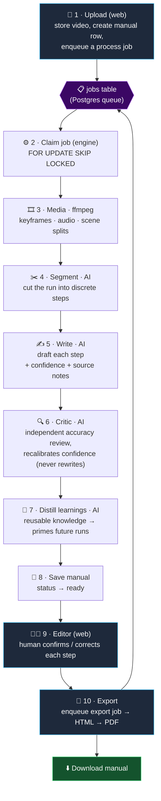

# Vitruvius

**Drop in a video of something being assembled → get back an editable, step-by-step instruction
manual (IKEA-style).**

The positioning is deliberate: _AI-generated draft instructions with a guided human revision editor_
— **not** a fully automatic generator. Every AI output carries a **confidence value** and **source
notes**, and a human confirms or corrects each step before export.

```
  🎥  assembly video                                 📘  step-by-step manual (PDF)
 ────────────────────►   [  Vitruvius pipeline  ]   ────────────────────────────►
                                                       + per-step confidence
                                                       + human-reviewed
```

---

## How it works

The pipeline runs as a chain of small stages — **each node has one clear job.** A SvelteKit web app
handles upload, review, and export; a separate containerized engine does the heavy lifting. They
never talk directly — only through the database and the shared `@vitruvius/core` contract.



> Stages **2–8** run inside the engine container. The web app only ever **enqueues** jobs and
> **polls** `manuals.status` — it never imports the engine or calls AI directly.

### Each node, one job

| # | Stage | Where | What it does |
| - | ----- | ----- | ------------ |
| 1 | **Upload** | web | Stores the video in Storage, creates a `manuals` row (`uploaded`), enqueues a `process` job. |
| 2 | **Claim job** | engine | Atomically claims a queued job (`FOR UPDATE SKIP LOCKED`) — no Redis. |
| 3 | **Media** | engine · ffmpeg | Extracts keyframes, audio, and scene/clip splits from the raw video. |
| 4 | **Segment** | engine · AI | Cuts the continuous footage into discrete assembly steps. |
| 5 | **Write** | engine · AI | Drafts each step's instruction, attaching a **confidence** and **source notes**. |
| 6 | **Critic** | engine · AI | A *separate* agent reviews accuracy and recalibrates `confidence` — it never rewrites the steps, so the trust signal stays independent of the generator. |
| 7 | **Learnings** | engine · AI | Distills reusable, core-scope knowledge into a store that **primes future runs** (better accuracy, fewer credits). |
| 8 | **Save** | engine | Persists the manual; moves `manuals.status` `processing → ready` (or `failed`). |
| 9 | **Editor** | web | A human reviews each step — `confidence`, `reviewStatus`, `sourceNotes` — and confirms or corrects. |
| 10 | **Export** | web → engine | Web enqueues an `export` job; engine renders HTML and prints a PDF (Playwright), stored for download. |

> 🧩 **Planned lane (spec 12):** when a digital model (CAD/mesh) accompanies the video, `packages/cad`
> parses it into a BOM + assembly tree + canonical views that *also* prime generation. Auxiliary,
> never required — a run with no model proceeds on video alone.

---

## The web / engine boundary

`apps/web` (SvelteKit) and `apps/engine` (worker) **never import each other**. They communicate only
through the database (the `jobs` table + manual rows) and the shared `@vitruvius/core` contract. This
is a **deploy boundary**, so the engine can later be rewritten in Python / on GPUs or extracted to
its own repo without touching the web app. ffmpeg, Gemini, and Playwright live in the engine only.

## Stack

| Concern           | Choice                                                                                                                                                                       |
| ----------------- | ---------------------------------------------------------------------------------------------------------------------------------------------------------------------------- |
| Language          | TypeScript everywhere                                                                                                                                                        |
| Monorepo tooling  | pnpm workspaces + Turborepo                                                                                                                                                  |
| Web app           | SvelteKit + Tailwind + shadcn-svelte                                                                                                                                         |
| Processing engine | `apps/engine` — standalone containerized worker (own deploy/scale cadence)                                                                                                   |
| Job queue         | Postgres-backed `jobs` table in Supabase (`FOR UPDATE SKIP LOCKED`) — no Redis                                                                                               |
| Database          | Supabase Postgres                                                                                                                                                            |
| File storage      | Supabase Storage                                                                                                                                                             |
| Auth              | Supabase Auth                                                                                                                                                                |
| Video processing  | ffmpeg (inside the engine container)                                                                                                                                         |
| AI runtime        | Google Gemini (video understanding) — stubbed in this bootstrap; credit-aware and provider-pluggable behind `packages/ai` (see [`docs/ai/ai-layer.md`](docs/ai/ai-layer.md)) |
| PDF export        | HTML template + Playwright print-to-PDF (inside the engine container)                                                                                                        |
| Node              | current active LTS                                                                                                                                                           |

## Getting started

```bash
pnpm install
cp .env.example .env   # fill in Supabase + Gemini values
pnpm dev               # turbo runs the web app (and engine) in dev
```

Useful workspace scripts: `pnpm typecheck`, `pnpm lint`, `pnpm build`, `pnpm test`.

## Layout

- `packages/core` — the frozen contract (types + zod schemas + enums).
- `packages/{db,media,ai,export}` — typed stubs, implemented per spec.
- `apps/web` — SvelteKit UI + thin server routes.
- `apps/engine` — the containerized worker.

## Docs & specs

- Architecture map: [`docs/ai/architecture.md`](docs/ai/architecture.md)
- The AI layer (agents, credit budget, Critic, learnings, BYO-license future): [`docs/ai/ai-layer.md`](docs/ai/ai-layer.md)
- Infrastructure & env vars: [`docs/ai/infra.md`](docs/ai/infra.md)
- Decisions (ADR-lite): [`docs/ai/decisions.md`](docs/ai/decisions.md)
- Task specs: [`specs/`](specs/) — one vertical slice per file (`01`–`12`).
</content>
</invoke>
