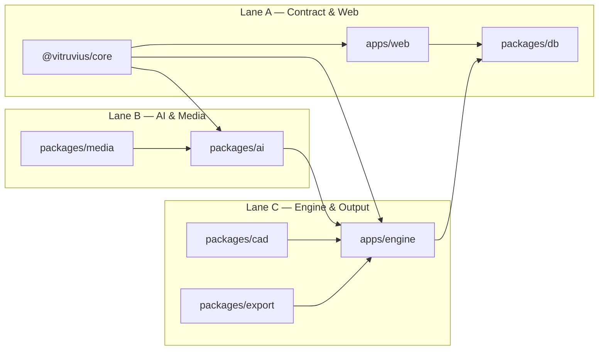

# Team organization

**Date:** 2026-06-21  
**Team:** Antonio, Giovanni, Stefano  
**Status:** Active — update this file when lanes, ownership, or coordination rules change.

This document officializes how the three of us divide work so we can develop **in parallel**
without blocking each other. It follows the repo boundaries in
[architecture.md](architecture.md) and the PR discipline in [pr-and-ci.md](pr-and-ci.md).

---

## Goal

- Ship vertical slices (one spec = one branch = one PR).
- Keep `apps/web` and `apps/engine` decoupled — they communicate only via the database and
  `@vitruvius/core`.
- Minimize merge conflicts on shared surfaces (`@vitruvius/core`, migrations, engine orchestrator).

---

## Three lanes

| Person       | Primary lane           | Owns                                                                                   | Parallel because…                                                               |
| ------------ | ---------------------- | -------------------------------------------------------------------------------------- | ------------------------------------------------------------------------------- |
| **Stefano**  | Contract & Web         | `@vitruvius/core`, schema/migrations in `packages/db`, `apps/web`                      | Web never imports engine or AI providers; can progress with mock manuals        |
| **Antonio**  | AI layer + PR approval | `packages/ai` — agents, prompts, credit discipline; **approves every PR** before merge | Each agent is a separate interface; sole merge gatekeeper for the team          |
| **Giovanni** | Engine & determinism   | `packages/media`, `apps/engine`, `packages/export`, `packages/cad`                     | ffmpeg, PDF, and CAD are engine-side; Giovanni integrates packages as they land |

### Lane A — Stefano (contract & web)

| Area            | Specs / packages                | Notes                                                                   |
| --------------- | ------------------------------- | ----------------------------------------------------------------------- |
| Shared contract | 01-core, extensions for 10–17   | **Gatekeeper** for breaking changes — see [Coordination](#coordination) |
| Database        | 02-db                           | Migrations coordinated with core contract changes                       |
| Upload & status | 03-web-upload                   | Done — extend for optional BOM/CAD in phase 1                           |
| Editor          | 08-web-editor                   | Step review, split/merge, BOM disambiguation (phase 1 extension)        |
| Regenerate UX   | 16-regenerate-job (web side)    | Enqueue jobs; no engine imports                                         |
| Versioning UX   | 17-manual-versioning (web side) | v1 → v2 enrich flows                                                    |

### Lane B — Antonio (AI layer)

| Area        | Specs / packages           | Notes                                                 |
| ----------- | -------------------------- | ----------------------------------------------------- |
| Segmenter   | 05-ai-segment              | In review — hand off to Giovanni for engine wiring    |
| Instructor  | 06-ai-instructions         | `writeInstructions`; target adds `caption`, `PartRef` |
| Critic      | 10-ai-critic               | Text-only review — never rewrites instructions        |
| Learnings   | 11-learnings               | Distill + priming; wired via agent inputs             |
| Illustrator | 14-ai-illustrate (phase 1) | After core exposes `illustrationUrl`                  |

Antonio does **not** wire `apps/engine`. He delivers validated agent interfaces in
`packages/ai` that Giovanni integrates.

**PR approval:** Antonio is the **sole approver** for every PR (Stefano's, Giovanni's, and his
own). Authors request review from Antonio; no PR merges to `main` without his approval. For PRs
authored by Antonio, a second pair of eyes (Stefano or Giovanni) is encouraged before he
self-merges, but the approval gate remains Antonio.

### Lane C — Giovanni (engine & output)

| Area          | Specs / packages     | Notes                                                         |
| ------------- | -------------------- | ------------------------------------------------------------- |
| Media         | 04-media             | In review (#20) — ffmpeg wrappers, engine-only                |
| Engine worker | 07-engine-worker     | **Single owner** for pipeline orchestration                   |
| Export        | 09-export            | HTML + Playwright PDF                                         |
| CAD ingest    | 12-cad-ingest        | Optional priming — deterministic, not illustrated deliverable |
| BOM map       | 13-bom-map (phase 1) | Deterministic-first; lives near `packages/cad`                |

Giovanni integrates Lane B deliverables into the process/export/regenerate job handlers.
He may use stubs until agents are merged.

---

## Coordination

### Contract gatekeeper (Stefano)

All shared data shapes live in `@vitruvius/core`. No package redefines them locally.

When a spec needs new fields (`critique`, `PartRef`, `illustrationUrl`, `JOB_TYPE: regenerate`, …):

1. Stefano opens (or assigns) a `feat(core)!:` PR with zod schemas and types.
2. Antonio and Giovanni **wait for merge**, then rebase their branches.
3. DB migrations, if any, land in the same PR or immediately after — never in parallel PRs.

### What must stay serial

| Surface                         | Rule                                             |
| ------------------------------- | ------------------------------------------------ |
| `@vitruvius/core` + zod schemas | One open breaking-change PR at a time            |
| Supabase migrations             | One author per migration batch                   |
| `apps/engine` pipeline wiring   | Giovanni only — no concurrent orchestrator edits |
| CI / shared workflows           | One PR; not split across lanes                   |

### What can run in parallel

| Work item                             | Condition                                               |
| ------------------------------------- | ------------------------------------------------------- |
| Web editor (08) + Instructor (06)     | Editor uses current bootstrap contract or mock fixtures |
| Engine (07) + any `packages/ai` agent | Engine imports stub/heuristic until agent PR merges     |
| Export (09) + Critic (10)             | Export template can use placeholder step fields first   |
| CAD (12) + Learnings (11)             | No shared files                                         |

### PR approval (Antonio)

| Rule                | Detail                                                                                     |
| ------------------- | ------------------------------------------------------------------------------------------ |
| **Approver**        | Antonio — all PRs, all lanes                                                               |
| **Author opens PR** | Assign Antonio as reviewer; CI (`checks-pass`) must be green                               |
| **Core / DB PRs**   | Stefano authors and gatekeeps the contract; Antonio still approves before merge            |
| **Antonio's PRs**   | Optional read-through by Stefano or Giovanni; Antonio approves and merges when CI is green |

This is a team convention on top of [pr-and-ci.md](pr-and-ci.md) — it does not replace CI or the
PR title/body rules.

### Stub strategy

To avoid blocking:

- **Giovanni** runs the engine against heuristic/mock agents until Antonio's PRs merge.
- **Stefano** builds editor UI against JSON fixtures validated by core zod schemas.
- **Antonio** tests agents in isolation (Vitest) without a running engine.

---

## Working agreements

1. **One spec = one branch = one PR** — see [pr-and-ci.md](pr-and-ci.md). No “and also” PRs.
2. **Antonio approves every PR** — all lanes; see [PR approval](#pr-approval-antonio). Stefano
   remains contract gatekeeper for `@vitruvius/core` and migrations, but does not substitute for
   Antonio's approval.
3. **Sync twice per week (~15 min)** — agenda:
   - What merges on core/db this week?
   - Any new job types or manual fields?
   - Who rebases on whom?
4. **Claim before coding** — post in the team channel (or GitHub issue assignee) which spec you
   are taking; do not start a spec owned by another lane without agreement.
5. **Update [implementation-progress.md](implementation-progress.md)** when a spec lands.

---

## Near-term backlog (baseline 06–12)

Current state: specs 01–03 done; 04–05 in review; 06–12 stubbed. See
[implementation-progress.md](implementation-progress.md).

| Sprint focus | Stefano                                         | Antonio                            | Giovanni                                  |
| ------------ | ----------------------------------------------- | ---------------------------------- | ----------------------------------------- |
| **1**        | Core extensions for 06/10; editor skeleton (08) | Instructor (06) + tests            | Merge 04; engine skeleton (07) with stubs |
| **2**        | Editor: review, split/merge                     | Critic (10) + Learnings (11)       | Wire real agents as PRs merge             |
| **3**        | Export trigger + status UX                      | Cache / credit discipline on 06/10 | Export PDF (09); end-to-end baseline demo |
| **4+**       | BOM disambiguation UI prep (08 ext.)            | Illustrator stub (14 tier 1)       | CAD ingest (12)                           |

**Phase 1 client deliverable** (specs 13, 14, 16, 17 + extensions 08/09) starts after baseline
runs end-to-end. Same lanes; same coordination rules.

### Example: three parallel PRs after 04 + 05 merge

| Author   | PR scope                                                  | Spec |
| -------- | --------------------------------------------------------- | ---- |
| Stefano  | `feat(web): editor skeleton with step review`             | 08   |
| Antonio  | `feat(ai): add Instructor agent`                          | 06   |
| Giovanni | `feat(engine): process job pipeline with media + segment` | 07   |

No shared hot files if core is stable; Giovanni depends on 04/05 being merged first.

---

## Phase 1 extensions (same lanes)

| Spec | Stefano                                  | Antonio                           | Giovanni                   |
| ---- | ---------------------------------------- | --------------------------------- | -------------------------- |
| 13   | Editor: resolve BOM candidates (08 ext.) | —                                 | BOM file parse + reconcile |
| 14   | Editor: illustration preview             | Illustrator + Compositor-lite     | Engine stage wiring        |
| 16   | Regenerate enqueue UI                    | Agent reuse (instruct/illustrate) | `regenerate` job handler   |
| 17   | Version chain UX                         | —                                 | DB + engine versioning     |

---

## Related docs

- [architecture.md](architecture.md) — web/engine boundary, pipeline phases
- [ai-layer.md](ai-layer.md) — agent roster, credit discipline, Critic rules
- [pr-and-ci.md](pr-and-ci.md) — PR title, CI gates, atomicity
- [implementation-progress.md](implementation-progress.md) — what is coded vs spec-only
- [client-alignment-assessment.md](client-alignment-assessment.md) — phase 1 target deliverable
